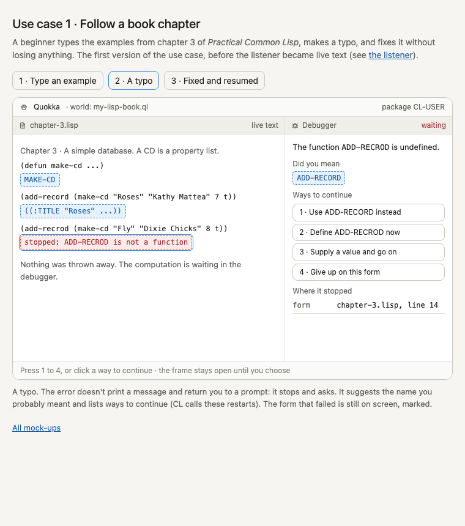
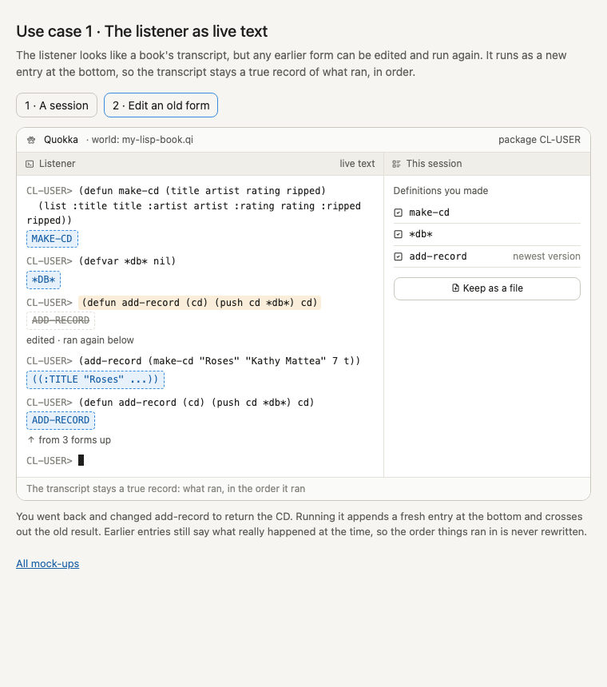
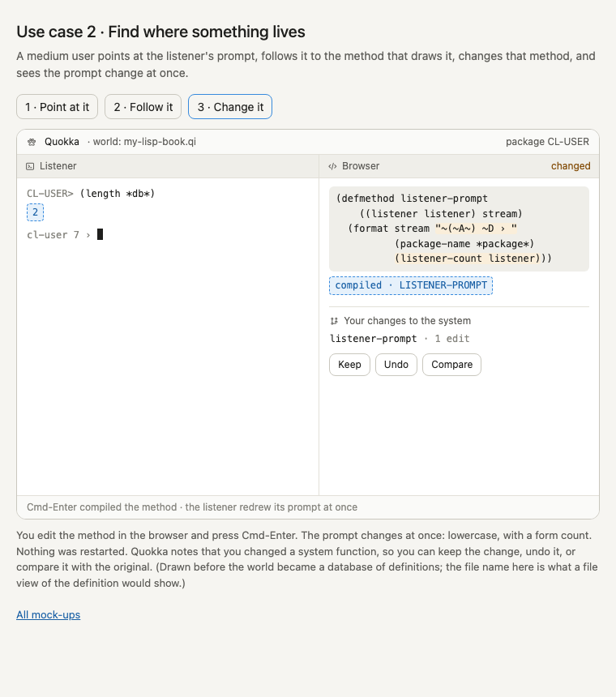
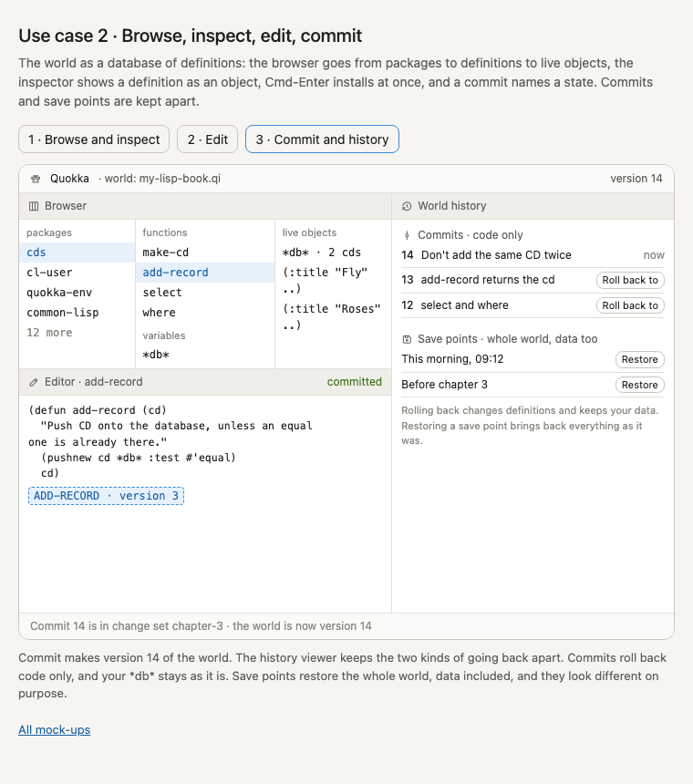
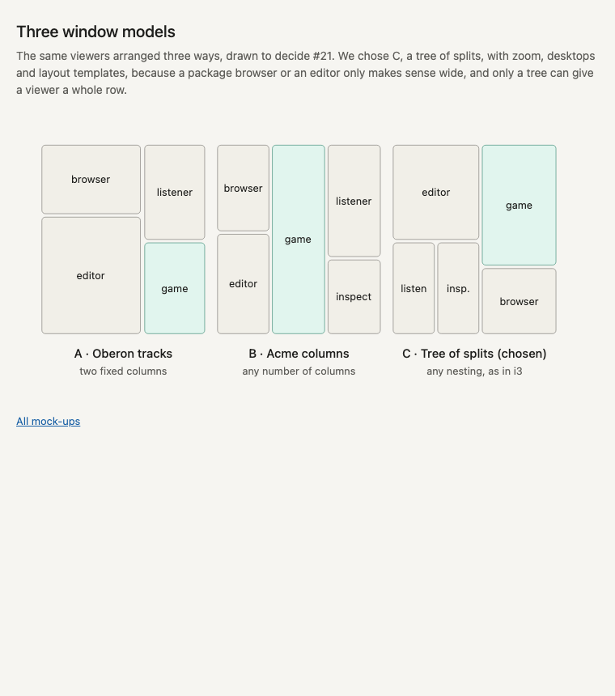

# The environment, on paper

> *Where this fits.* Eight parts have built a language: a machine, a
> compiler that compiles itself, a library measured against the standard,
> objects and conditions. None of it has a screen. A person meets Quokka
> through a terminal, one form at a time, which is enough to test a Lisp and
> not enough to live in one. This chapter is the design of what a person
> will see and use when phases 4 to 6 are built: the listener, the browser,
> the inspector, windows, saving, sound. It was worked out before any of it
> exists, from the people who will use it and from mock-ups of what they
> would do, so that the machinery of the next phases is built for a purpose
> rather than discovered by accident. Reading it, you will see why a Lisp
> environment can treat a program as a live database instead of a pile of
> files, and what that one decision changes everywhere else.

*Status: designed 27 Nov 2026, issues [#126](https://github.com/quokka-lisp/quokka-lisp/issues/126) and [#21](https://github.com/quokka-lisp/quokka-lisp/issues/21); nothing here is built. The design is in `docs/design.md` under* Environment and UI *, and the mock-ups are in [book/src/mockups](../mockups/index.html).*

## Designing before building

Most of what this book has described was designed a step ahead of being
built, because the next step was small enough to see. The environment is
different. It is three phases of work, its parts depend on one another, and
some decisions made in the first of them (what the display protocol can
describe, for instance) would be expensive to undo in the third. So we
stopped building for a day and asked who will sit in front of Quokka, and
what they will be in the middle of doing.

We settled on three kinds of user. A beginner writes snippets and small
programs while following a Lisp book, such as *Practical Common Lisp* or
*Land of Lisp*; this is also how we expect to use Quokka first ourselves. A
medium user browses the system to see how it is made, as people do in
Smalltalk, changes small things by following tutorials (how the tiles look,
a colour scheme, the prompt), and writes whole applications with windows,
graphics, sound and MIDI. An advanced user extends Quokka itself, down to
the compiler.

From these came six use cases, and we drew a **mock-up**, a picture of the
screen at each step, for every one of them:

1. Follow a book chapter: type the examples, make a mistake, fix it, go on.
2. Find where something lives: go from something on the screen to the code
   that drew it, change it, and see the change.
3. Build a small application with a user interface, a Rolodex.
4. Run a program with graphics and sound, and change it while it runs.
5. Save your work and come back to it the next day.
6. Change the system itself, such as the compiler.

Drawing them was the point. A sentence like "the inspector shows a
definition's connections" sounds finished until you have to draw the box
and decide what goes in it. Each mock-up raised a question nobody had
asked, and most of this chapter is those questions and what we decided.
Restarts, processes, slices and the copying collector from earlier parts
all reappear below, seen this time from the outside.

## A book, a typo, and a transcript

A book about Lisp shows a **listener**, the window where you type a form
and see its value, as a transcript: `CL-USER> (+ 1 2)`, then `3`, then the
next prompt. A listener is what chapter 40 called the read-eval-print loop,
seen as something on a screen.



Our first mock-up put the book's code in a file instead, with each result
appearing under the form that produced it. Then the beginner made a typo,
`add-recrod` for `add-record`, and the mock-up had to say what happens. In
a terminal, an error prints a message and returns you to the prompt, and
whatever the computation was doing is gone. Quokka's principle 5 says an
error is a conversation, so here the computation stops and waits in a
debugger, which offers ways to continue: use `add-record` instead, define
`add-recrod` now, supply a value, or give up on this form. Common Lisp calls
these **restarts**, and Part VIII is building them. Choosing the first one
corrects the text and finishes the form as if the typo had never happened.
The suggestion of a nearby name is something SBCL does not offer; in Quokka
it is a handler written in Lisp, which anyone can change.

The file did not survive the next question, though. Both books show a
transcript, and a beginner copying from one expects to see one. We chose a
listener that looks like the books' transcripts and is live text like every
other viewer: you can scroll up, edit any earlier form and run it again.

That raised the question of where the edited form runs. A notebook such as
Jupyter runs it where it stands and replaces the old result. We append it at
the bottom instead, strike the old result through, and point back to where
the form came from. In Lisp, order matters more than it looks: `*db*` holds
whatever every earlier `add-record` left in it, and a notebook run in place
can show a page whose state nobody could reproduce by reading it from the
top. Notebook users call this hidden state, and it is their commonest
complaint. Appending keeps the transcript a true record of what ran, in the
order it ran.



## Pointing at things

The second use case begins with curiosity: where does the prompt come from?
The user right-clicks it, and a menu offers *Show the code that drew this*.

This works because of **presentations**, an idea from the Symbolics Lisp
machines that the design has carried from the start. Everything Quokka
prints remembers the object it stands for, so a result on the screen is a
handle on the object and not just text. The mock-up made us extend the idea
in two directions. The prompt is not the value of anything, so the record of
a piece of output must remember the function that produced it as well as
the object it shows. And drawings must be presentations too, so that in the
fourth use case you can click the player in a running game and get the
player object itself. The first is a requirement on the display protocol of
phase 4, the boundary between Lisp and the screen, and it is cheap only if
the protocol has it from the beginning.



Following the prompt leads to a method, `listener-prompt`, in a browser that
shows which generic function it belongs to and who calls it. The user
changes it, presses Cmd-Enter, and the prompt changes at once, with nothing
restarted.

## A world that is a database

The mock-up of that browser first showed a file name, `lisp/env/listener.lisp`,
and a line number. Drawing it made us notice that the file was the wrong
thing to show. What the user wants is the method: what it uses, what uses
it, its versions, the change set it belongs to. A file is just where its
text happens to be kept.

So we turned the design around. A world is not compiled code with source
files somewhere else; it is a live database whose rows are definitions.
Each definition is an object holding its name, its kind, its package, its
source text, the compiled object it made, and its versions. Files become a
view of the database, the way a dump is a view of a SQL database. Smalltalk
has worked this way since the 1970s, with methods as objects in the image,
and Pharo, a modern Smalltalk, writes them out to one file per class only so
that Git has text to version.

Two pieces of this are new work. The compiler throws the source away today
(`function-lambda-expression` always answers "unknown"), so a definition
must keep it. And the browser's "used by" needs a **who-calls index**, a
table from each function to its callers, which the compiler has to update
every time it installs a definition. SBCL keeps one, and so did Genera. It
costs little if the compiler maintains it from the start, and a great deal
if it has to be reconstructed later.



Then came the question of what Cmd-Enter does. Our mock-up drew Git's
order: an edit is a draft, and nothing changes in the world until you
commit. Smalltalk's order is the opposite: saving a method installs it at
once, and grouping changes is a separate act. We chose Smalltalk's. Under
Git's order every experiment would need a commit, or a temporary install,
which is Smalltalk's model under another name. So Cmd-Enter installs a
definition at once, the world runs it from the next call, and the
definition is marked as changed since the last commit. A **commit** gives a
name and a number to a state you are happy with.

Going back comes in two kinds, and we keep them apart on purpose. Rolling
back to a commit restores definitions and nothing else, so your data, such
as the cards in a Rolodex, stays as it is. Restoring a **save point**, an
image snapshot of the kind chapter 7 described, brings back the whole world,
data included. One button that did both would undo work you did not mean to
undo.

## Packages, systems and files

With definitions as rows, a file is no longer the unit you work in. We start
an application by creating a package, empty, and fill it one definition at
a time, each in its own small editor, as methods are edited in a Smalltalk
browser. A stray parenthesis in one definition cannot break its neighbours,
because they are not in the same text.

Applications usually need several packages, and the obvious way to group
them was missing. Common Lisp has no sub-packages: `rolodex.import` is a
different package from `rolodex` that only looks related. The grouping CL
practice uses is the **system**, from ASDF's `defsystem`, a named set of
parts that load and travel together. We made a system an object in the
world that lists its packages explicitly. The browser suggests dotted names,
but membership is stored, never guessed from a prefix.

A package can still be opened as text when many definitions change at once:
a view the world generates, with a bar marking each definition and its
version. Exporting a system writes exactly this text, one file per package.
That brought back a question the design had already answered the other way.

The design's list of decisions said that files are the truth and an image
is a fast cache of them, with every edit written back to its file. A world
that is a database says the opposite. We kept the newer answer and found a
rule that serves both. A running world is the truth, and each system may
have a **home**, a directory on a file host, to which a commit writes the
changed packages. Quokka's own system has its home in the Git checkout, so
`lisp/` is current after every commit, and the cold build and the fixpoint
tests read what they always read. A `git pull` that changes a file is read
back definition by definition, so two people who change two different
functions in one file never conflict, and two who change the same function
always do.

Writing back has to reproduce a file byte for byte, because Quokka's own
sources are full of comments that explain why, and this book is written
from them. The reader discards comments, as CL's reader must, so the
environment reads a file twice: once with `read` for the forms, and once as
text, to cut it into one stretch of source per definition. The comments
above a definition belong to it.

In a browser there is no directory to write to. Chromium has an interface
for asking the user for one, but Firefox and Safari do not, and we decided
not to build on a capability that only one browser engine has. A browser
world has no home until the remote file host exists, and its files are
exports you download.

## Sending an application to a friend

The fourth use case ended with a friend who wants to play the game and does
not know Lisp. Our first idea was an app mode: a link opens your world with
the game filling the screen and the environment one button away. We
rejected it, because a world opened from a link runs someone else's code
with far less deliberation than downloading and opening a file.

Instead a system that names a **main view** can be exported as a web page:
the page, the VM as WebAssembly, and a stripped world holding the
application. It comes in two kinds. A *locked* export leaves out the
editor, the inspector and the browser; it is smaller and simpler, and not
secret, because whoever has the file can take the image apart. An *open*
export keeps them, so the friend can change the game and send their changes
back as a change set.

Stripping a world is called **tree shaking**: keep what is reachable from a
root, here the main view, as the collector of chapter 6 keeps what is
reachable from its roots. Its weakness is late binding. A call through
`(funcall (intern name))` reaches code that no reference points at, the
shaker removes it, and the program fails only when that path runs, on
someone else's computer. LispWorks, which calls this *delivery*, offers six
levels of it for that reason. We chose to keep the whole language in a
locked export, compiler and reader included, and remove only the
environment. The whole compiled world was about 360 KB at the warm rebuild
of chapter 41, so shaking the language out would save a few hundred
kilobytes, and that is not worth a class of failure nobody can test for.

A locked application has no debugger, so an error nobody handles shows a
plain page: the application stopped, its message, *Restart the
application*, and *Save a report*. That is the restart menu of Part VIII
with one choice made in advance.

## Data that must not leave

An exported world carries its data. The Rolodex's cards are reachable from
its main view, so the shaker keeps them, and a friend who opens your
Rolodex sees your address book. We first proposed a dialog that listed
every variable and shipped it empty unless you said otherwise. What we
chose instead puts the decision into the program, where a reader of the
code can see it. Two classes and one generic function, all in Lisp, as the
design sketches them (`docs/design.md`, *Private data*; proposed names):

```lisp
(defclass private-object () ())          ; my objects never leave this world
(defclass private-store () (...))        ; a collection of private objects

(defgeneric object-for-export (object))  ; what an export writes instead
(defmethod object-for-export ((s private-store))
  (make-instance (class-of s)))           ; a store exports as an empty store
(defmethod object-for-export ((o private-object))
  (error 'private-object-exported :object o))
```

A Rolodex built on them keeps its cards in a `private-store`, and every
export asks `object-for-export` about each object it writes. Everything
that is not private ships as it is, so the responsibility lies with the
developer, through the design of the data. A private card reached some
other way, from a list of recently viewed cards, say, makes the export fail
and show the path to it, because quietly dropping it would ship a different
program from the one that was written.

This protects against sharing by accident, not against a hostile program:
an author who wants to leak data can simply not use the classes. It is also
a first lesson in **object capabilities**, the model of Mark Miller's E
language, in which you can use only what you hold a reference to. If the
only way to a card is through its store, a plug-in given the store's
reading interface and not its adding one cannot change your contacts.

## No Save button

The fifth use case asked what happens when you close the tab. A world saves
itself as you work, so there is no Save button and no question on closing.

The technique has a name, **prevalence**, from Prevayler, a Java library of
2002 by Klaus Wuestefeld: keep the data as live objects in memory, write a
snapshot now and then, and append every change to a **journal** as it
happens. To recover, load the last snapshot and replay the journal. It was
right about something the industry did not want to hear at the time: most
applications' data fits in memory, and a snapshot and a journal together
are a database. A Lisp world is already the memory, so Quokka can take the
idea further than a Java library could.

For code, the journal records each definition as it is installed. Data is
harder, because it changes through every `setf` and `push` in the heap, and
journalling each store into an object would slow every one of them and
fill the journal with noise from the compiler's own tables. So data is
journalled the way Prevayler meant it, by commands and not by mutations: a
store declared *journalled* writes each operation (add this card, change
that phone number) to the journal before it changes anything, which
databases call **write-ahead logging**. A Rolodex's store is then both
private and journalled.

A journal grows, so a world takes a **checkpoint** from time to time: it
writes a new snapshot, loads it back to check it, switches to it, and only
then deletes the journal entries the snapshot contains. A crash before the
switch leaves the old snapshot and the whole journal untouched. Checkpoints
lose no state, only the points in between that could otherwise be replayed
to, so they run without asking. Pruning history, dropping old snapshots or
old versions of definitions, asks first.

We kept one more idea as research. The VM has no clock, slicing is
invisible to Lisp (chapter 2), and a host request is the only way out of a
world (chapter 31), so a world is deterministic given its host's answers.
Record those answers, and a whole world could be replayed from a snapshot,
or stepped backwards in a debugger. Few systems can even consider this; we
can because of decisions made for other reasons long ago.

## Changing the compiler from inside

The sixth use case is the advanced user's. The compiler is a set of
definitions in the system `quokka`, browsed and edited like any other, but
installing one is different: a change to the compiler installed in the
world you work in changes how the next fix to the compiler is compiled. So a
definition in system `quokka` asks before it installs, and offers to try
the change in a copy.

The copy is a second world, started from a save point and running beside
yours in a worker of its own. It installs the change, rebuilds itself with
the warm rebuild of chapter 41, and runs what `scripts/check.sh` runs today:
the fixpoint of chapter 42, the differential files, the ansi-test ratchet.
Only when they pass do you bring the change into your own world. A copy is
cheap because all of a world's state is in its heap (rule 4), an image can
be saved and loaded in the middle of a computation (chapter 30), and the VM
has no globals two worlds would share.

## Windows

Quokka's design has always wanted tiled viewers that never overlap, after
Oberon. What it had not decided was the model, and the mock-ups gave us
evidence before we chose.



Oberon divides the screen into two fixed tracks, a wide one and a narrow
one, each holding a column of viewers. Acme, which Rob Pike built for Plan 9
around 1993, keeps the columns and lets you add as many as you like. A
tiling window manager such as i3 keeps a tree of splits, in which any area
can be divided again. Every mock-up we had drawn could be drawn with
columns, and columns are the simplest to build and explain, so we expected
to choose them. We chose the tree instead, because some viewers only make
sense wide: a package browser with its columns, an editor with long lines.
A tree can give such a viewer a whole row and let the others share what is
left, and columns cannot.

Three additions came with it. Any viewer can be **zoomed** to fill the
screen for a while and then return exactly where it was, which a game or a
long text wants. A **desktop** is a named arrangement you switch between, an
idea from *Rooms*, which Austin Henderson and Stuart Card built for
Interlisp-D at Xerox PARC in 1986; we left out Rooms' windows that appear
in several rooms at once, the part that made it hard to reason about. And a
**layout template** is an arrangement with named, empty slots, so that an
application opens on a desktop of its own with its main view in the slot
`:main`.

The window manager is Lisp, by rule 1, and knows a viewer only through a
small protocol, again in proposed names from the design:

```lisp
(defgeneric viewer-title (viewer))                 ; shown in its title bar
(defgeneric display-viewer (viewer stream))        ; draw the contents as output records
(defgeneric viewer-input (viewer event))           ; a key or a click
(defgeneric viewer-commands (viewer))              ; its commands, for menus and the command line
(defgeneric viewer-minimum-size (viewer))          ; how small it can usefully be
(defgeneric viewer-state (viewer))                 ; what restores it, as plain data
```

`viewer-minimum-size` is how a browser that needs width tells the tree so,
and `viewer-state` is what lets a desktop be restored after the night. A new
kind of viewer is a subclass and a `display-viewer` method. Oberon divided
the work in the same place, with one module knowing rectangles and another
knowing text; Quokka gets the division from generic functions.

Every window operation is a command, an ordinary function that keys and
mouse gestures are bound to. There are no mouse chords, because trackpads
have no three buttons, and there is a command line in the style of
Genera's, where you type *Inspect* and then click any object on the screen
to say which.

## Sound

Sound was not in the design at all until the brainstorm, and it follows the
display's rule: Lisp says what to play, and the host plays it. The VM
cannot produce the samples itself as they play. Sound hardware wants 48,000
numbers a second per channel, on time, and a late block is a click you
hear; a VM that runs in slices, has no clock and can stop to collect
garbage cannot promise that. SuperCollider made the same split in 2002,
between its language and its synthesis server. Lisp either describes a
sound from a small set of parts (oscillators, envelopes, filters) or
computes a buffer of samples ahead of time and hands it over. MIDI, which
Safari lacks, is an optional capability that a host answers or declines,
like a microphone the user has to allow.

## What did it cost?

The largest cost is a decision reversed. "Files are the truth" was simple,
already written down, and matched how every other language is built. The
world as truth makes the environment better and every file operation
harder: write-back must be exact, comments must be kept with the right
definition, and reading a changed file becomes a merge.

The tree of splits is more to build and to explain than columns, which
every mock-up would have fitted. We paid that for viewers that need width,
and paid again with templates, which are what answer the tree's hardest
question, where a new viewer goes.

The who-calls index, keeping source in definitions, journalled stores and
the private classes are all work that a file-based environment would not
need. Each is small, and each has to be in place before the thing that
depends on it, which is why they are written down now.

## What is still missing?

All of it. Phase 4 builds the display protocol and the first live-text
viewer, and it must be able to describe layout and remember which function
drew each piece of output. Phase 5 builds presentations and the inspector.
Phase 6 builds the rest: the browser, the database of definitions, the
window manager, desktops, saving, export. Restarts, which the first
mock-up needed most, are being built now in Part VIII.

The mock-ups are kept with the book, one page for each, with a button for
every step, and their captions say where the design moved on after they
were drawn.
